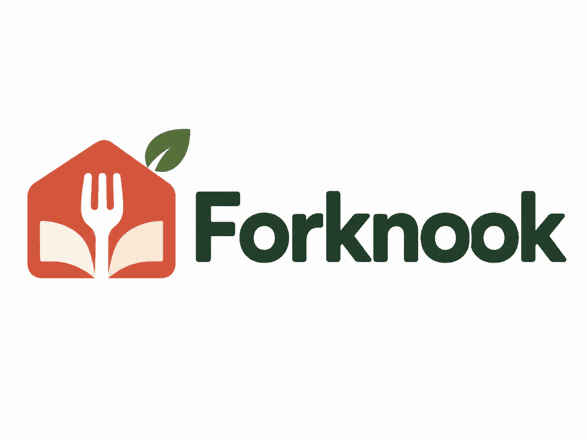

# Forknook — Family Recipe Management System (v2.0.0 testing release)

Forknook is a **standalone**, self-hosted family recipe manager. No KitchenOwl server, account or API token is needed to operate Forknook. This project expands the former Recipe Importer, and retains the existing image/video/website recipe extraction implementation and server updater for compatibility.



## Built in this release

| Area | Features |
| --- | --- |
| Security and administration | One-time first-run claim, own SQLite users, individual passwords (PBKDF2), 30-day hashed bearer sessions, admin/member roles, admin user management, last-admin safeguard, login throttling, disabled-user session revocation |
| Recipes | Shared family collection, create/view/edit, search, tags, categories/colors, source attribution, personal **Made Before** and **Want to Make** flags, per-user made count |
| Imports | Public recipe websites (structured markup), Facebook/Instagram videos where accessible, paste, screenshots via OCR, uploaded video with local Whisper and OCR, RSS/Atom feed subscriptions and manual import. **Every import has a preview/edit step before saving**. Platform restrictions and speech parsing limitations remain; do not treat incomplete extraction as accurate. |
| Shopping | Shared lists, custom items, check off, remove; create shopping list directly from a selection of recipes. Raw ingredient wording and quantities are preserved instead of guessing units or conversions. |
| Meal planning | Calendar-style weekly touch view, breakfast/lunch/dinner/snack meal scheduling, portions, removal. |
| iOS and browser | Responsive, touch-sized web UI/PWA under `/app/` with Safari Add to Home Screen support. iPad requires HTTPS for service-worker caching. Private API responses are **never** cached by the service worker. |
| Android | Native installable APK using the same self-hosted web interface in a protected WebView, with Android share-sheet support for recipe links, images and videos. Local Windows Gradle-wrapper APK build. KitchenOwl username/password are no longer required. |
| Updates | Server's original GitHub-release/checksum/restart/rollback mechanism is retained, retargeted to `gigabytegrove/forknook`. Image and dependency changes still require a Docker image redeploy. |
| Migration | Admin JSON import with **dry run first**, no overwrites/deletes, duplicate-name skips and migration audit counts. Admin can export Forknook data as JSON. |

## Safe test deployment — without touching Recipe Importer

Publish and run **`ghcr.io/gigabytegrove/forknook:2.0.0`** in a separate Dokploy Compose app, without overwriting the original Recipe Importer container. Use port `8999` internally and a unique host port or proxy hostname. The new installation gets **its own** `/data` volume and therefore does not alter existing Recipe Importer configuration or existing KitchenOwl content.

```yaml
services:
  forknook:
    image: ghcr.io/gigabytegrove/forknook:2.0.0
    container_name: forknook
    restart: unless-stopped
    ports:
      - "9000:8999"
    environment:
      WHISPER_MODEL: "base"
      OMP_NUM_THREADS: "1"
      OMP_THREAD_LIMIT: "1"
      OPENBLAS_NUM_THREADS: "1"
      MKL_NUM_THREADS: "1"
    cpus: 1.0
    mem_limit: 1536m
    memswap_limit: 1536m
    read_only: true
    security_opt:
      - no-new-privileges:true
    cap_drop: [ALL]
    pids_limit: 64
    volumes:
      - forknook-data:/data
      - forknook-models:/models
      - forknook-temp:/tmp
volumes:
  forknook-data:
  forknook-models:
  forknook-temp:
```

Open `http://YOUR-DOCKER-HOST:9000/app/` on the LAN (or an HTTPS URL through your reverse proxy). Find the **Forknook first-run setup code** in `docker logs forknook`, then create an administrator account. Create additional accounts from Administration. Every account logs in directly to Forknook.

**Important:** The legacy Recipe Importer endpoints remain accessible for migration and compatibility. The old UI is at `/legacy`, but Forknook does not require its KitchenOwl setup.

## PWA on iPad

Use an HTTPS reverse-proxied Forknook domain in Safari. Open `/app/`, sign in, then choose Share → Add to Home Screen. The UI is designed for touch and supports recipes, shopping lists, scheduling, importing, categories and administration. PWA offline caching covers **only the static shell**, not personal data, recipes or private API results. Network connectivity is required for recipe management.

## Native Android app: build locally like Calden

Clone `https://github.com/gigabytegrove/forknook` once to your Windows user folder. On later builds, update the same checkout with `git pull --ff-only origin main`. Use the existing Android SDK/JDK from Calden, then:

```powershell
cd "$HOME\forknook"
git pull --ff-only origin main
powershell.exe -NoProfile -ExecutionPolicy Bypass -File ".\android\build-apk.ps1"
```

Expected APK: `android\app\build\outputs\versioned\Forknook-v2.0.0-debug.apk`. The script builds/tests, validates the package/signature, and writes `SHA256SUMS.txt`. This is sideloadable debug-signed software, not a Play Store-signed release. The user selects the Forknook server URL on first launch; Android shares from websites and media open in the Forknook interface.

## KitchenOwl migration — copy first, verify, then decide

**Do not remove KitchenOwl until you have independently verified your data.** Forknook's importer currently accepts JSON files containing a list of recipe objects, or objects with a `recipes` array. Some KitchenOwl exports have different shapes; check yours before importing. The importer deliberately will not claim complete migration of every household, linked image, shopping list, planner entry, or user account.

1. Make a normal backup of your existing KitchenOwl installation (including its database/media) and Forknook `/data` volume.
2. Export/copy recipe JSON without changing KitchenOwl.
3. In Forknook Administration → Migration & backups, select JSON and choose **Preview migration**. Review the number of valid entries.
4. Choose Import only after confirming the preview. Existing Forknook recipe titles are not overwritten; reimporting skips duplicate titles.
5. Compare recipe counts, ingredients, directions and sample photos against KitchenOwl. Import of photographs/attachments and non-recipe records remains to be validated separately.
6. Keep KitchenOwl online until household records, planning and shopping workflows have passed acceptance testing.

`GET /api/v2/admin/export` provides authenticated JSON export for recoverability. Use a full backup of the Docker volume for the complete SQLite database and hashed accounts; JSON export excludes account passwords and sessions.

## Administration and API

`/api/v2` is Forknook's separate native API. All private routes require a Forknook `Bearer` session. Sensitive endpoints (user administration, database export and migration, updater) require an admin role. The API doesn't use KitchenOwl tokens. A one-time setup code prevents first-visitor account hijacking. Backups should protect the private `/data` mount. Use HTTPS outside the trusted LAN.

The preserved legacy `/api/parse` and `/api/kitchenowl` routes are retained for migration compatibility; `/api/v2/imports/preview-*` is the supported non-destructive import preview API for new clients.

## Verification and known limits

Run `cd server && python -m pytest -q tests`, `node --check server/web/forknook.js`, and the GitHub Actions Android build. This release is an **integration test candidate**, not yet production-certified against your actual Family KitchenOwl export, iOS version, Android device or internet video sources. Known limitations: automatic background feed polling is not implemented (manual browse/import), automatic consolidation/servings scaling of identical shopping items is not implemented, video providers can reject retrieval, and native iOS offline recipe editing/synchronization is not implemented.

The software uses one Docker container, one CPU limit, 1536 MiB maximum memory, SQLite on disk, and no separate model daemon. Whisper is loaded per request and released after transcription. Backup and capacity validation are required before relying on Forknook as the only copy of your recipes.
